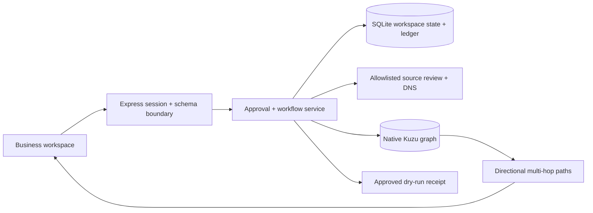

# System design

## Data flow



Each mutation resolves `allco` or `huasheng` on the server. Reads and writes never accept a business identity from a posted workspace object. Every graph ID is namespaced and every edge query constrains both endpoints and the relationship owner. This prevents accidental cross-business mixing inside the shared project. Project access remains shared, rather than user-specific RBAC.

## Authoritative state and concurrency

SQLite stores one versioned JSON workspace per business. `BEGIN IMMEDIATE` makes credit checks, deductions, audit events, and dry-run receipts atomic. Profile saves use an expected revision. Draft edits and approvals use message versions. JSON payloads have strict schemas and size limits; clients cannot post approval flags, balances, graph nodes, or pipeline metrics.

Kuzu is a derived projection of authoritative workspace records. Graph writes are serialized. Rebuilding a business deletes only that business's nodes and recreates edges from its persisted research and outreach. Errors roll back native graph transactions. The next query can rebuild a projection after a graph failure. The workspace and graph do not share a distributed transaction; a graph projection failure does not undo an already-recorded dry-run receipt. Such a message remains immutable and retry-safe.

On restart, interrupted jobs become failed and reserved credits are refunded; jobs and messages are never automatically replayed. The single-process design is intentional for the embedded databases. Multi-instance scaling needs a persistent job queue, a shared relational database, and a graph server.

## Native graph schema

| Node | Meaning / key properties |
| --- | --- |
| Company | Researched equipment maker or cited prior employer; businessId, name, source |
| Person | Published professional identity and role; buying authority may remain unknown |
| Product | This workspace's product offering, selected families, supplier source |
| Competitor | Named public competitor or explicitly labeled alternative hypothesis |
| Signal | Cited application/leadership context or local outreach event |

| Directional relationship | Evidence |
| --- | --- |
| Person → works_at → Company | Public role citation; current buying authority not inferred |
| Company → matched_to → Product | Application hypothesis and source; not technical approval |
| Signal → signal_for → Company | Primary publication or product context |
| Product → competes_with → Competitor | Sourced category overlap or labeled alternative hypothesis |
| Person → previously_employed_at → Company | Published history, when available |
| Company → contacted_via → Signal | Exact draft ID and delivery mode; dry run distinctly labeled |
| Person → replied_to → Signal | Explicitly reported reply with eligible message and matching published respondent; demo/manual provenance retained |

The following query runs in Kuzu rather than a JavaScript graph simulation:

```cypher
MATCH (p:Person)-[:works_at]->(c:Company)-[:matched_to]->(product:Product)
WHERE p.businessId=$id AND c.businessId=$id AND product.businessId=$id
RETURN p.name AS person, c.name AS company,
       product.name AS product, p.data AS evidence
```

## Research and decisions

Discovery currently checks a curated US OEM collection. Geography, selected product families, and exact domain exclusions are enforced. Narrative exclusions, target company size, and revenue remain qualification questions when source data is unknown; they are never silently marked as satisfied.

The score exposes application (35), geography (20), segment (20), public role/context (10), confirmed size (5), and confirmed purchase intent (10). Unknown size and intent receive zero. Scores rank research priority, not purchase likelihood. Each account retains citations and source fetch timestamps/status. Cached source-based statements are distinguishable from successful current fetches. Source text is untrusted evidence and is never executed as instructions.

The default intake recognizes a small, explicit grammar. Optional OpenAI structured intake/drafting is implemented behind project-specific configuration and explicit processing acknowledgement. It is contract-tested with intercepted SDK HTTP fixtures, not live-verified. Proposals persist as business-scoped assistant runs with profile fingerprints. Accept/adjust/dismiss review applies only typed ICP fields; models never grant approval or select recipients. Template and AI drafts share the exact-message approval gate. Source membership checks do not prove the semantic truth of a proposed claim. Search and vendor enrichment remain unconnected.

Inference reserves local credits before transmission, deduplicates requests, records confirmed provider token usage, rejects stale workspace revisions, and discards results if the profile changes. Restarted in-flight runs fail without automatic replay. Local refunds do not establish remote billing refunds. The official SDK uses strict Structured Outputs, store:false, bounded output, a timeout and no automatic retries. Only PROJECT_OPENAI_API_KEY is accepted; global OPENAI_API_KEY is ignored. Dummy configuration never enables a request. Credentials and raw provider errors are not returned to the browser.

## Exact-message approval

A profile fingerprint covers company, products, capabilities, commercial terms, ICP, and expansion decisions. A message fingerprint covers business, profile fingerprint, recipient, subject, body, channel, sequence step, and version. Approval requires explicit review of the current version. Editing message content or campaign context invalidates approval. Dispatch checks that exact fingerprint again, checks balance atomically, suppresses the alternate A/B variant, records a unique receipt, and charges once. Only local dry runs exist; there is no external send path.

A future delivery adapter must persist provider idempotency keys, explicit dispatching/accepted/unknown outcomes, retry-safe reconciliation, suppression/opt-out checks, and scheduled HITL rechecks. Do not treat an HTTP acceptance as delivered mail.

## Bonus integrations: current boundary

Band: the local Planner → Builder → Reviewer → Security reviewer steps are ordered job summaries. They are not autonomous model agents, Band peer registration, @mention handoffs, or token/cost telemetry. Use project-specific credentials later to register actual agents and persist real message IDs/usage. No chat messages have been posted.

Flexprice: local reservation/consumption/refund entries are durable and per-business/per-lead. No remote wallet or billing event exists. A real integration should use a durable outbox keyed by ledger event ID, ingest events with project customer mapping, reconcile asynchronous acceptance, and avoid charging twice. The documented [event API](https://docs.flexprice.io/api-reference/events/ingest-event) accepts event IDs and processes events asynchronously. Remote wallet enforcement and event ingestion must be verified with project credentials before claiming the bonus.

Snyk: CI configuration includes SCA and SAST without ignoring failures. Missing credentials cause an explicit setup failure. A real published passing workflow is still required.

## Deployment and limits

The Node server serves built assets and `/api` on one origin. A non-loopback bind requires a project token and configured origin. Source URLs are fixed to allowlisted HTTPS hosts; redirects are revalidated, private resolutions blocked, response sizes capped, and fetches time limited. This is a bounded research tool, not a general URL fetch proxy. DNS preflight is not a full egress sandbox; enforce public-only network egress for production.

Source is published at [yuansshi/gtm_hackthon](https://github.com/yuansshi/gtm_hackthon); the desktop/analytics update is in PR #2. The [public demonstration](https://youtu.be/lXMJIpLYfAc) uses local extraction, source templates, and dry-run outreach. No externally hosted deployment, passing Snyk scan, live-verified model/search/enrichment, verified email, sent outreach, Band connection, or Flexprice connection is claimed. Docker deployment is prepared but untested locally. The archived native Kuzu dependency is a production maintenance risk and should be replaced/evaluated before broad deployment.


## Credit reloads

The billing page presents the active workspace wallet, server-defined packs, custom amounts, usage rates, filterable history, and persisted reload receipts. SQLite atomically records the request ID, grant, receipt, and before/after balances. Replaying a completed ID returns its original receipt; changing its pack or amount is rejected. Custom amounts and the maximum wallet balance are enforced before a grant. Reloads do not grant research/message approval. Workspace reset retains the wallet and billing receipts.

The current implementation adds demo credits without payment and is labeled accordingly. No card or real payment information is accepted. The legacy grant endpoint uses the same validation. Real billing requires verified checkout/webhook fulfillment, project customer mapping, and individual user/tenant authorization.


## Dashboard cohorts and attribution

Board, List, and Analytics share the same selected account population. Analytics then filters event and outbound-record timestamps and attribution type. Each conversion uses distinct account IDs from a common recorded-contact cohort; outcomes must follow a matching contact. Incomplete histories remain visible in raw milestone counts. A zero denominator is unavailable. Simulated and provider-accepted outbound records are separate, and acceptance is not inbox delivery.

Variant observations require an explicit same-account reply-to-draft reference and chronological order; manual stage updates are not silently assigned to prior messages. Channels, sequence steps, drafting methods, and delivery modes remain separate. The Record outcome dialog captures confirmed user-reported or demo entries with optional eligible message links. New context advances unsent message versions and clears approvals; HITL shows those reports for review. The current application has no provider reply feed. Detailed definitions and validation are in [Pipeline analytics](pipeline-analytics.md).


## Outcome persistence and projection

[Outcome reporting](outcome-reporting.md) persists an append-only account event and audit entry atomically in SQLite before refreshing Kuzu. Same-business request IDs deduplicate retries before revision checks; changed input cannot reuse an ID. The server fixes actor and provenance, validates eligible message status/business/account/time and any published respondent, and never infers provider verification. New reports invalidate editable unsent-message approvals and versions for that account.

Backdated history can be stored without stage changes. Future records and stage regression over a newer event are rejected. Graph failures leave a saved pending projection; an explicit replay or graph query repairs it. Unknown respondents remain unknown; they do not create Person nodes. Manual notes stay in the local application and human review surface, not the model context.
