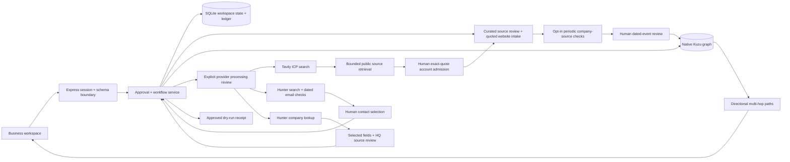

# System design

## Data flow



Each mutation resolves `allco` or `huasheng` on the server. Reads and writes never accept a business identity from a posted workspace object. Every graph ID is namespaced and every edge query constrains both endpoints and the relationship owner. This prevents accidental cross-business mixing inside the shared project. Project access remains shared, rather than user-specific RBAC.

## Authoritative state and concurrency

SQLite stores one versioned JSON workspace per business. `BEGIN IMMEDIATE` makes credit checks, deductions, audit events, and dry-run receipts atomic. Profile saves use an expected revision. Draft edits and approvals use message versions. JSON payloads have strict schemas and size limits; clients cannot post approval flags, balances, graph nodes, or pipeline metrics.

Kuzu is a derived projection of authoritative workspace records. Graph writes are serialized. Rebuilding a business deletes only that business's nodes and recreates edges from its persisted research and outreach. Errors roll back native graph transactions. The next query can rebuild a projection after a graph failure. The workspace and graph do not share a distributed transaction; a graph projection failure does not undo an already-recorded dry-run receipt. Such a message remains immutable and retry-safe.

On restart, interrupted jobs become failed and reserved credits are refunded; jobs and messages are never automatically replayed. The single-process design is intentional for the embedded databases. Multi-instance scaling needs a persistent job queue, a shared relational database, and a graph server.

## Native graph schema

| Node | Meaning / key properties |
| --- | --- |
| Company | Researched equipment maker or cited prior employer; businessId, name, source |
| Person | Published professional identity and role; buying authority may remain unknown |
| Institution | Auxiliary education reference keyed by reviewed full name and source hostname; not a buyer account |
| Product | This workspace's product offering, selected families, supplier source |
| Competitor | Named public competitor or explicitly labeled alternative hypothesis |
| Signal | Cited application/leadership context or local outreach event |

| Directional relationship | Evidence |
| --- | --- |
| Person → works_at → Company | Public role citation; current buying authority not inferred |
| Company → matched_to → Product | Application hypothesis and source; not technical approval |
| Signal → signal_for → Company | Primary publication or product context |
| Product → competes_with → Competitor | Sourced category overlap or labeled alternative hypothesis |
| Person → previously_employed_at → Company | Published history, when available |
| Person → studied_at → Institution | Owner-reviewed public study/degree claim with exact biography and separate institution identity passages |
| Company → contacted_via → Signal | Exact draft ID and delivery mode; dry run distinctly labeled |
| Person → replied_to → Signal | Explicitly reported reply with eligible message and matching published respondent; demo/manual provenance retained |

The following query runs in Kuzu rather than a JavaScript graph simulation:

```cypher
MATCH (p:Person)-[:works_at]->(c:Company)-[:matched_to]->(product:Product)
WHERE p.businessId=$id AND c.businessId=$id AND product.businessId=$id
RETURN p.name AS person, c.name AS company,
       product.name AS product, p.data AS evidence
```

## Research and decisions

Discovery checks a curated US OEM collection plus business-scoped owner-admitted website candidates. Research a website retrieves up to two public same-site HTTPS pages; exact quoted manufacturer, US geography, and application evidence must be reviewed before account admission. Company-name presence, source membership, current profile/revision, domain deduplication, and optional published-email selection are enforced. New accounts remain unshortlisted with no manufactured people, mailbox verification, or purchase intent. Source presence does not establish semantic truth. Geography, selected product families, and excluded domains/subdomains are enforced. Narrative exclusions, target company size, and revenue remain qualification questions when source data is unknown; they are never silently marked as satisfied.

The score exposes application (35), geography (20), segment (20), public role/context (10), confirmed size (5), and confirmed purchase intent (10). Unknown size and intent receive zero. Scores rank research priority, not purchase likelihood. Each account retains citations and source fetch timestamps/status. Cached source-based statements are distinguishable from successful current fetches. Source text is untrusted evidence and is never executed as instructions.

The default intake recognizes a small, explicit grammar. Optional OpenAI structured intake/drafting is implemented behind project-specific configuration and explicit processing acknowledgement. It is contract-tested with intercepted SDK HTTP fixtures, not live-verified. Proposals persist as business-scoped assistant runs with profile fingerprints. Accept/adjust/dismiss review applies only typed ICP fields; models never grant approval or select recipients. Template and AI drafts share the exact-message approval gate. Source membership checks do not prove the semantic truth of a proposed claim. Optional Tavily search rebuilds an inspectable plan from the approved ICP, requires consent, filters domains locally, and stages bounded source pages for human quote review. The fixed-endpoint adapter is fixture-tested; live project search and autonomous validated-account admission remain unverified. Search snippets never become approved company facts. Hunter Domain Search and Email Verifier are implemented behind explicit project configuration and request acknowledgement; live project contact enrichment is unverified. Public API test data and intercepted fixtures do not establish actual contacts. Accepted website candidates persist in customCandidates and are rechecked on source refresh. Quote/contact loss or failed retrieval sets a sticky evidenceNeedsReview flag, deselects the account, and blocks qualification and message approval until a fresh quoted-source review. Editable unsent draft versions advance and approvals clear; sent records and stage history remain unchanged. In-flight model and MX work cannot apply to a changed account context. Account admission is stored before derived graph projection, with idempotent projection repair. See [Website intake](website-intake.md).

Inference reserves local credits before transmission, deduplicates requests, records confirmed provider token usage, rejects stale workspace revisions, and discards results if the profile changes. Restarted in-flight runs fail without automatic replay. Local refunds do not establish remote billing refunds. The official SDK uses strict Structured Outputs, store:false, bounded output, a timeout and no automatic retries. Only PROJECT_OPENAI_API_KEY is accepted; global OPENAI_API_KEY is ignored. Dummy configuration never enables a request. Credentials and raw provider errors are not returned to the browser.

## Exact-message approval

A profile fingerprint covers company, products, capabilities, commercial terms, ICP, and expansion decisions. A message fingerprint covers business, profile fingerprint, recipient, subject, body, channel, sequence step, and version. Approval requires explicit review of the current version. Editing message content or campaign context invalidates approval. Dispatch checks that exact fingerprint again, checks balance atomically, suppresses the alternate A/B variant, records a unique receipt, and charges once. Dry run is the default. The optional project SendGrid path additionally binds the exact live sender/footer and mode, requires a separate final acknowledgement, persists an immutable attempt before a single POST and retains uncertain outcomes without resend. Signed receipts update delivery status and provider restrictions; acceptance never creates a reply. The main setup stays disabled. See [Project email delivery](email-delivery.md).

A future delivery adapter must persist provider idempotency keys, explicit dispatching/accepted/unknown outcomes, retry-safe reconciliation, suppression/opt-out checks, and scheduled HITL rechecks. Do not treat an HTTP acceptance as delivered mail.

## Bonus integrations: current boundary

Band: local discovery role summaries remain distinct from the optional project-agent integration. Four dedicated identities can connect through fixed official REST/WebSocket endpoints and hand off a reviewed public packet by mentions. Planner/Reviewer/Security run deterministic policy checks; Builder uses a source template or separately acknowledged project model. Provider IDs, returned token usage and actual portal credits persist; the result still needs exact human approval. No live Band room messages were posted during development, and the main dummy setup stays off. See [Band integration](band-integration.md).

Flexprice: local reservation/consumption/refund entries are durable and per-business/per-lead. The optional project adapter implements a durable usage outbox, explicit customer/wallet bindings, uncached credit checks and same-ID reconciliation without automatic repost of unknown ingestion. It is fixture-tested; the main dummy setup creates no remote wallet or billing event. The documented [event API](https://docs.flexprice.io/api-reference/events/ingest-event) accepts event IDs and processes events asynchronously. Remote wallet enforcement and event ingestion must be verified with project credentials before claiming the bonus.

Snyk: CI definitions include SCA and SAST, but the owner temporarily disabled these jobs. They are skipped; real re-enabled passing scans remain required.

## Deployment and limits

The Node server serves built assets and `/api` on one origin. A non-loopback bind requires a project token and configured origin. All public-page source paths share the DNS-pinned HTTPS reader: curated accounts, website intake/refresh, prospect retrieval, and market signals. Curated initial hosts additionally remain allowlisted. Each connection pins a validated public address while retaining TLS hostname verification, rejects mixed public/private DNS answers, stays within the same company site, and permits HTTPS/443 only. Each page is bounded to four request hops, one 15-second deadline, 1 MB HTML and 48,000 retained text characters. Source requests send no cookies, authentication headers or ambient proxy requests; source text is data. DNS pinning does not replace a production public-only egress policy, and no full network isolation is claimed. See [Source retrieval](source-retrieval.md).

Source is published at [yuansshi/gtm_hackthon](https://github.com/yuansshi/gtm_hackthon); the desktop/analytics update is in PR #2. The [updated 2:54 desktop demonstration](demo-current/README.md) uses actual captured UI states, local Heart narration, extraction, source templates, native Kuzu and dry-run outreach; its verified local video awaits the owner’s YouTube submission-terms confirmation. The [older public demonstration](https://youtu.be/lXMJIpLYfAc) remains archived. No externally hosted deployment, passing Snyk scan, live-verified model/search/enrichment, verified email, sent outreach, Band connection, or Flexprice connection is claimed. The Docker runtime now includes all shared source modules; its Linux CI workflow builds/boots the image, exercises an isolated authenticated workflow and verifies native storage after container recreation and a full offline copy/restore into separate storage. Original native nodes/edges/paths are inspected before restored startup; exact profile/receipt/ledger/audit/owner records are compared across fresh sessions. This is a synthetic restoration rehearsal, not a backup of the operating campaign or configured disaster recovery. The same process probe passes locally, while Docker remains unavailable on this machine. Public hosting still requires a project destination. The archived native Kuzu dependency is a production maintenance risk and should be replaced/evaluated before broad deployment.


## Credit reloads

The billing page presents the active workspace wallet, server-defined packs, custom amounts, usage rates, filterable history, and persisted reload receipts. SQLite atomically records the request ID, grant, receipt, and before/after balances. Replaying a completed ID returns its original receipt; changing its pack or amount is rejected. Custom amounts and the maximum wallet balance are enforced before a grant. Reloads do not grant research/message approval. Workspace reset retains the wallet and billing receipts.

The current implementation adds demo credits without payment and is labeled accordingly. No card or real payment information is accepted. The legacy grant endpoint uses the same validation. Real billing requires verified checkout/webhook fulfillment, project customer mapping, and individual user/tenant authorization.


## Dashboard cohorts and attribution

Board, List, and Analytics share the same selected account population. Analytics then filters event and outbound-record timestamps and attribution type. Each conversion uses distinct account IDs from a common recorded-contact cohort; outcomes must follow a matching contact. Incomplete histories remain visible in raw milestone counts. A zero denominator is unavailable. Simulated and provider-accepted outbound records are separate, and acceptance is not inbox delivery.

Variant observations require an explicit same-account reply-to-draft reference and chronological order; manual stage updates are not silently assigned to prior messages. Channels, sequence steps, drafting methods, and delivery modes remain separate. The Record outcome dialog captures confirmed user-reported or demo entries with optional eligible message links. New context advances unsent message versions and clears approvals; HITL shows those reports for review. The current application has no provider reply feed. Detailed definitions and validation are in [Pipeline analytics](pipeline-analytics.md).


## Outcome persistence and projection

[Outcome reporting](outcome-reporting.md) persists an append-only account event and audit entry atomically in SQLite before refreshing Kuzu. Same-business request IDs deduplicate retries before revision checks; changed input cannot reuse an ID. The server fixes actor and provenance, validates eligible message status/business/account/time and any published respondent, and never infers provider verification. New reports invalidate editable unsent-message approvals and versions for that account.

Backdated history can be stored without stage changes. Future records and stage regression over a newer event are rejected. Graph failures leave a saved pending projection; an explicit replay or graph query repairs it. Unknown respondents remain unknown; they do not create Person nodes. Manual notes stay in the local application and human review surface, not the model context.


## Vendor contact boundary

Hunter requests use fixed HTTPS endpoints with manual redirect handling, a 25-second timeout, bounded JSON bodies, and redacted errors. Only a project-enabled key can configure live use; browser-supplied or global/personal keys are not used. A search transmits the current account domain, and verification transmits only a same-domain address returned by that account’s search. No supplier profile, other business, message, or outcome note is sent.

Enrichment runs persist with business/account IDs, profile and evidence fingerprints, request hashes, credit reservations, and request-attempt counts. Completed retries return the existing result. Pending verification requires explicit polling or local closure; restart fails interrupted work and refunds local reservations without implying vendor refunds. Source-free and masked/off-domain records cannot supply a selected address. Verification validity is derived from matching email, explicit checks and flags, and a recent real provider date; vendor scores do not imply purchase authority.

A contact review validates candidate membership, verifier linkage, context, age, and owner acknowledgement. It updates selected contact metadata, retains vendor-role provenance in the graph and reported respondents, and invalidates only this account’s editable unsent recipients/versions. Sent receipts and existing stage history remain unchanged. The durable decision precedes graph projection; retry repairs projection without replaying the decision or charge. Provider processing restrictions gate verification, selection, exact-message approval, and dry runs, and survive campaign reset. Optional project email adds signed opt-out ingestion and provider suppression preflight; live verification and full consent management remain future work. Details and verification: [Contact enrichment](contact-enrichment.md).


## ICP-driven prospect search

The search request carries a UUID, current revision, one or two approved product families, exact displayed queries, and processing acknowledgement. The server rebuilds the plan before reserving two local credits or contacting Tavily. It transmits no supplier/private profile fields or exclusion list. Fixed basic-search requests use bounded JSON, manual redirect rejection, redacted errors, and no automatic retries.

Safe search URLs are grouped by domain. Local exclusions, known accounts, queued domains, and directories are removed before up to three domains/two pages each enter the existing DNS-pinned source reader. Successful pages become ready website intakes atomically after the approved-profile hash is rechecked. Search history distinguishes failed sources, local exclusions, duplicates, and ready/accepted proposals. Profile changes discard staged results and refund local credits. Restart recovery does not replay provider requests. Shared run cost stays business-scoped; actual returned provider usage is separate. See [Prospect search](prospect-search.md).


## Dated signals and periodic ingestion

Each account can retain one or two same-site company news/job URLs, explicit daily/weekly authorization, its approved-profile fingerprint, next due time, bounded source text, 50 evidence records and 100 check receipts. A server timer checks due monitors each minute, with one account per business per tick and no catch-up replay. Manual and scheduled checks share the same two-credit reservation, revision/profile/source/configuration guards and retry-safe UUID. Disabled or stopped monitors do no work; insufficient credit or changed schedule context pauses them. Restart refunds interrupted reservations and requires explicit resumption.

Deterministic keyword/date extraction creates proposals, with exact event/date passages, content hashes and retrieval timestamps. No automatic intent points or stage progress results. Human acceptance requires a successful source less than 24 hours old, quote presence and a valid non-future source date. Accepted positive context is usable for 180 event days and seven source-check days. Failed retrieval or removed quotes marks prior evidence for review and invalidates editable unsent versions. Accepted negative evidence holds qualification even if its source becomes unavailable; only explicit withdrawal removes the effect.

Reviewed events project to native Signal nodes and directional signal_for edges. Native multi-hop queries return fresh Signal → Company → Product paths, with buying-cycle interpretation explicitly unconfirmed. Decisions persist before projection, and retry/query repairs graph failures. Template/model context includes eligible public event quotes and dates, without sending local review notes to a model. Linked evidence is checked at approval and dry run; prepared templates can be regenerated when their signal context changes. HITL acknowledgement resets when its version/context changes. Details and limits: [Market signals](market-signals.md).

## Shared public-page transport

Curated research now uses the same DNS-pinned HTTPS reader as website intake, custom-account refresh, prospect retrieval and market signals. The initial curated host remains allowlisted, every redirect stays within the original company host (with the www alias), and each connection pins a freshly validated public address while preserving TLS hostname checks. The shared reader imposes one 15-second deadline, 1 MB HTML and 48,000 retained characters. The former generic-fetch path is removed. Fixed official provider API requests remain separate. See [Source retrieval](source-retrieval.md) and its integration evidence.


## Company enrichment and qualification

The project Hunter adapter supports fixed `companies/find` requests with the stored account domain and the documented Clearbit-style schema. Company and contact work share reservation/concurrency/restart protections. Request consent, current revision, profile/account-source fingerprints, project configuration and credit availability precede work. A valid 404 no-match completes/consumes the lookup; failure refunds local credits without asserting a vendor refund. Processing restrictions persist across campaign reset. Up to 30 company lookups are retained per campaign.

The adapter retains bounded company fields and vendor indexing date, discarding unrelated phone/email/social/identifier/coordinate payloads. Current company pages are independently retrieved through the shared pinned reader. Company application accepts only selected field keys from an exact completed run, plus uncertainty acknowledgement. Optional HQ corroboration requires a source-member exact passage naming headquarters, returned city and country from a source under 24 hours old. This supports city/country for 30 days, rather than independent verification of the whole vendor record.

Employee range comparison is local, distinguishes overlap/conflict/unknown, and never awards confirmed-size points. Revenue/currency and classification-edition uncertainty remain explicit. HQ country is a qualification boundary only by explicit choice; US operating locations are not silently equated to global headquarters. Reviewed non-overlapping employee ranges, selected out-of-territory HQ criteria, stale/source-changed company profiles and processing restrictions hold qualification. Owner withdrawal removes the profile effect without reselecting the account.

Reviews persist before graph projection and repair without repeating charges/version invalidations. Source refresh preserves the profile and its hold; Company node data and inspectors retain vendor/source provenance. Unsent drafts advance versions and clear approval on company decisions. Model requests can include only current corroborated public HQ evidence from these fields, with a linked company review checked at approval/dry run; estimates are not asserted in copy. No stage outcomes, contacts, sent receipts or industry cohorts are rewritten. See [Company enrichment](company-enrichment.md).


## Published people and employment traversal

People retrieval uses the shared pinned HTTPS reader for one account-owned role page and an optional employer-owned identity page. Persistent jobs reserve two local credits; strict revision/profile/account identity checks, exact quotations, 24-hour source acceptance and request hashes separate retrieval from human publication. Accepted reviews and relationship decisions persist before repairable Kuzu projection. Interrupted requests refund without replay. Later checks suspend reviews on missing quotations or source failure; warm eligibility also expires after 30 days.

The graph overlays exact name/source reviews while retaining existing person indexes and reply attribution. Former-employer domains resolve to current account Company nodes where available or separate domain-keyed Company references. Legacy name-only entities remain explicitly unresolved. Four native edge combinations traverse an owner-attested anchor and a reviewed target through shared current/former employment, then continue through works_at and matched_to. Candidate IDs are selected before traversal; output is capped at 100 possible paths. Results disclose source quotes, actor/time and unknown dates, employment overlap, acquaintance, willingness and authority. Private relationship notes and these graph-only people are excluded from model requests. Local graph snapshots clear on graph-input changes; billing-only progress does not invalidate a snapshot. See [People and introductions](people-introductions.md).


## Optional project Flexprice credit enforcement

A fixed-host project adapter validates customer/external ID, wallet/environment, active prepaid status, credit conversion and explicit uncached freshness. A synchronous store policy checks a short-lived verified snapshot inside local reservation transactions. Charged HTTP routes and scheduled source work fetch fresh balances before reserving; pending usage serializes execution per business. Immediate dry-run and in-transaction settlement/refund paths share the same policy. Both the existing local demo budget and external wallet gate apply.

Successful settlement atomically persists a gtm_credits_consumed outbox event with stable ID, credit quantity, operation and opaque business-scoped lead allocation. A bounded worker sends queued events once and polls provider processing. Acceptance, matching meter/price attribution and fresh-wallet reconciliation are separate states. Ambiguous sends are not reposted automatically. Same-ID retries require explicit confirmation, not-found lookup and age bounds. Destination, environment or conversion changes cannot retarget unresolved usage. Consent decisions use a separate version and binding fingerprint, so unrelated telemetry cannot invalidate wallet synchronization or overwrite a pause. Campaign reset retains pending usage and consent.

Only metadata goes to Flexprice; messages, contact details, source passages and relationship notes stay local. A dry run is never reported as an external send. Credits are fixed-point integers in micro-units, separate from currency. This serializes one portal process’s operations; it is not a provider-side atomic reservation across independent consumers. Configured meter/price IDs and owner acknowledgement do not independently verify actual price amounts. Dummy mode stays off, and live project verification/production payment authorization remain outstanding. See [Flexprice integration](flexprice-integration.md).

## Competitive evidence

Business-scoped competitor retrieval shares the pinned public-source reader and store metering gate. Exact passage decisions persist separately from proposals; graph projection can be repaired without repeating a decision or retrieval. Current reviewed source facts can populate native Competitor nodes, while owner comparison notes are excluded from graph fingerprints/facts, model context and outreach. Snapshot age, source change, profile context, withdrawal and supersession limit active support. Details and evidence boundaries: [Competitor research](competitor-research.md).

## Published buying-window reasoning

Reviewed account-owned signals can form fixed native Signal → Signal evaluation links or Signal → Competitor supplier-change links. Source-acceptance versions, business/account context, quoted window dates, source currency, competitor review and qualification holds constrain eligibility. Public edge proof excludes profile/account binding keys. Native traversal rechecks dates and freshness and caps each result set at 100 paths; owner interpretations remain unverified and never authorize outreach. SQLite decisions are retry-safe and projection-repairable. Graph snapshots check time boundaries and read workspace changes each minute without automatically spending graph credits. Details: [Buying signals](buying-signals.md).

## Shared education reasoning

Education retrieval binds an account-owned biography to an exact current person review and a separate institution identity page. Two public-person-research credits cover the two bounded HTTPS snapshots. Review requires exact person/institution passages and an explicit interpretation of study/attendance or degree. Literal/term checks are guardrails, not independent semantic or identity verification. Full normalized institution name plus canonical source hostname form the identity key; aliases, campuses and institutions with the same name on different domains are not automatically merged.

Native Kuzu persists auxiliary Institution nodes and studied_at edges. A real multi-hop query joins an owner-attested anchor through a shared institution to a different current reviewed person, then its eligible Company → matched_to → Product path. Both edges retain their own passage and institution source. Current person/education IDs, exact-review connection binding, thirty-day freshness and query-time checks constrain results; queries cap output at 100 possible paths. Dates, degree validity, attendance, campus identity, overlap, acquaintance, willingness and buyer authority remain unconfirmed. Education does not enter model drafts, select recipients or satisfy HITL approval.

Profile/account/preference changes during retrieval discard results and refund local reservations once. People or education refreshes suspend lost/failed supporting passages. Supersession, withdrawal and attestation revocation remove path support. Decisions persist before repairable graph projection; restart does not replay network work. Graph context includes person/education validity, and idle checks clear stale snapshots without automatically charging for another query. See [Education introductions](education-introductions.md) for desktop flow, boundaries and the 16 education tests; the complete suite also includes the delivery contract tests.

## Optional project email delivery

The SendGrid adapter uses project-only enable flags and fixed regional HTTPS endpoints. Business sender/from/group identities are distinct; checked sender metadata and footer are owner-confirmed before live approval. Every send rechecks exact profile/account/source/preference context, sender identity and suppression, then obtains a fresh billing gate. The immutable dispatch ID, approved copy and reservation precede the single provider POST. A known rejection refunds once; ambiguous responses and interrupted sends retain a locked unknown reservation. Neither restart nor a new request ID can replay that account/channel/step.

Only the raw signed SendGrid webhook bypasses browser session/CSRF checks; it verifies P-256 ECDSA before bounded event parsing and matches dispatch/business/recipient/message identity. Events are deduplicated, terminal status resists processed/deferred regression, and no event implies a reply. Accepted attempts settle once and project delivery properties to Kuzu. Provider restrictions and immutable history survive reset; unknown/in-flight/conflicting attempts block reset. Idle desktop polling refreshes receipts without paid graph queries. See [Project email delivery](email-delivery.md) for setup, rate/history limits, unknown-outcome investigation and mock-only validation.

## Message brief and synthesis constraints

New desktop drafts persist a canonical messageBrief containing audience, tone, maxWords and CTA. Shared UI/server options and strict HTTP schemas reject extra or unsupported values. Templates vary role greetings/focus and tone, preserve citations/qualification context and add the exact selected CTA. Accepted-event categories/dates remain linked to original reviewed evidence; follow-up wording does not assert prior contact. Model context receives the same bounded brief; the service rejects noncompliant output before draft creation, refunds once and preserves actual token usage. Model request fingerprints include the brief.

Objective word/subject/CTA validation is repeated at approval and dry/live dispatch; all brief fields are bound into messageHash. Editing the saved brief advances the version and clears approval/live identity metadata. A changed unsent template brief regenerates copy, while dispatched/unknown attempts stay immutable. Missing brief fields on legacy drafts retain the original approval hash; new UI drafts supply an explicit brief. Word counts exclude URLs/citation numbers and the separate live footer. Tone and audience suitability remain human review decisions. See [Message briefs](message-brief.md).

## Project Band orchestration

One socket per dedicated role uses header-only agent authentication, Phoenix V2 and on_conflict=reject. Reviewed business rooms share these four connections while their context, request IDs, ledger and run histories remain scoped. Identity/participant checks and company-bound confirmation precede connection; exact public packet acknowledgement precedes each run. Routing uses a versioned envelope bound to current profile/account/preferences/target variant/room/roster. Persist each outbound intent before one POST; unknown acceptance never reposts automatically. Exact late delivery can reconcile an eligible connected run, or the owner may abandon further processing without asserting provider cancellation/delivery.

Each role claims its mentioned message before work and deduplicates processing across WebSocket/backlog delivery. Builder calls the existing typed template/model workflow and credit gates. A run/context guard prevents stopped model results from applying; known failed-request usage remains recorded with a local refund. Reviewer checks citation/brief coverage; Security checks HTTPS and source membership. Neither is independent fact/security verification. The final Planner status is human_review_required, with no draft approval, outreach or pipeline progression. Reset blocks active/uncertain work, stops idle connections and retains history. Restart disables project connections and never replays messages or model requests.

The lazy desktop team disclosure shows access review, connection state, role events, provider message IDs and model token/portal-credit telemetry. It exposes no credentials or fabricated dollar cost. Optional Band draft methods require a current packet preview and explicit acknowledgement; model mode also requires OpenAI processing consent, reset on context changes/submission. Model usage absent from a response stays unknown. Existing approved/populated server workspaces cannot be overwritten by stale browser-profile backups; the migration check runs against server state before import. Details, limits and remaining live evidence: [Band integration](band-integration.md).

### Value-proposition observations

New desktop message briefs carry an explicit application-fit, supplier-qualification or engineering-collaboration hypothesis. The typed focus guides templates/model requests, appears in exact Band packets and is included in the existing message hash. Editing it advances the unsent version and revokes approval without rewriting copy or proving a benefit. Older four-field briefs preserve their exact hash shape. Immutable simulated/accepted records feed value-proposition/channel/variant/step/method/mode groups; absent/unknown focus is Unrecorded, with no inference from A/B labels or message text. The table-only focus filter does not change milestone denominators. Exact same-account, post-outbound reply links remain mandatory. This is descriptive reporting, not randomized or causal experimentation.

### Container operation

The image uses an explicit build COPY list, a non-root runtime user, a writable `/data` volume and a minimal unauthenticated `/healthz` route that does not query workspace data/providers or consume credits. Network startup requires a strong project token and an exact HTTPS browser origin (loopback HTTP is allowed); Secure cookies derive from that configured origin, without trusting arbitrary proxy headers. Shutdown drains HTTP before stopping workers and closing the embedded stores. Container CI has no outbound network or published port; synthetic seed/probe code is passed on stdin and absent from the image. After removal, a separate graph reader inspects persisted Kuzu nodes/paths before the app can reconstruct them. Public deployment, real provider processing and Snyk remain separate verification. See [Deployment](deployment.md).

### Sales ownership and manual next actions

Each account can retain local management metadata: recorded owner, current task with optional canonical UTC due instant and open/completed status, management version and newest 20 actor/time snapshots. The typed management route checks business scope, session/CSRF/origin, workspace revision and management version. Retained request IDs deduplicate replay without restoring old assignments. Source proposals cannot write owner/task data; existing records survive research refresh. Operational fields do not enter graph facts/fingerprints, Band packets or model requests, and they do not alter message approvals, stage events or credits. Board/List/Analytics use the same selected owner/task cohort; owner strings do not grant access or establish a verified actor. See [Lead management](lead-management.md).

### Adjacent segment review and query binding

An optional expansionAdjustments profile map holds bounded names/internal rationales against fixed business catalog IDs. It never replaces source identity. The full profile hash includes populated adjustments while absent keys leave legacy hashes unchanged. Profile edits revoke research and unsent approvals. Accepted source-linked hypotheses can become a selected query target only after approval; the server recomputes the exact bounded US OEM plan and binds request identity to the optional segment ID. Changed plans and in-flight profile edits cannot apply stale research. Search history is immutable, source quote admission remains mandatory, and private rationale is excluded from query/model/Band/graph paths. See [Expansion review](expansion-review.md).

### Buyer persona targets and contact context

Optional bounded ICP title/seniority strings extend the same strict typed review and full-profile fingerprint, without injecting defaults into legacy hashes. Literal extraction preserves complete source values/clauses; catalog hypotheses remain source-linked research targets with confidence capped at 0.5. Contact-search runs snapshot only their local persona targets. Candidate text comparisons preserve raw observations, unknowns and unsupported criteria, with no inferred rank equivalence. Contact decisions retain that comparison; old searches never acquire today’s criteria retroactively. Vendor HTTP requests remain domain/address-only, and profile changes invalidate old results. See [Buyer personas](buyer-personas.md).

### Product and capability intake

Product intake extends the typed field union with company.description and existing business-specific capabilities.<key> values. Scope checks allow only the selected business’s catalog fields; review writes a string value with unknown status and cannot elevate evidence. Literal quotes preserve units and qualifications. Labeled product/commercial values are excluded from local buyer-criteria matching, and blank labels cannot swallow a following line. Per-value provenance and legacy hashes remain compatible; graph/draft context retains qualified technical inputs while exact profile/HITL guards still apply. Product confidence uses a collapsed disclosure beside the existing coverage list. See [Product intake](product-intake.md).

### Internal commercial intake

Three optional bounded commercial fields preserve supplied monetization, pricing-framework and contract-target wording. Local labels and strict model suggestions share the typed ICP/commercial review schema, now extended by business-scoped product/capability fields; namespace-aware application and provenance distinguish these values from ICP company-revenue thresholds. Defaults do not change legacy profile hashes. Profile approvals bind the full plan, while outbound model briefs remove raw values and duplicate confidence rows; Band, search and native graph projection exclude them. Owner exports and acknowledged intake-model requests retain planning context. These are unverified internal targets, not established prices or unit economics. See [Commercial planning](commercial-planning.md).
