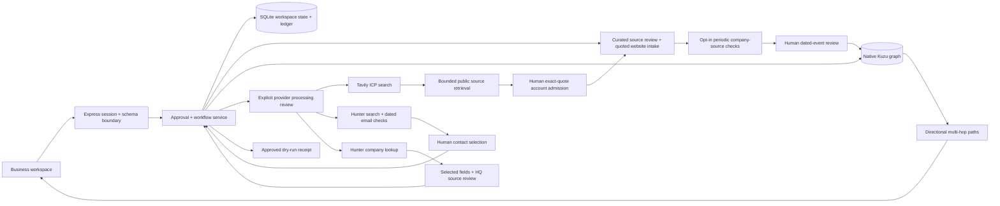

# System design

## Data flow



Each mutation resolves `allco` or `huasheng` on the server. Reads and writes never accept a business identity from a posted workspace object. Every graph ID is namespaced and every edge query constrains both endpoints and the relationship owner. This prevents accidental cross-business mixing inside the shared project. Project access remains shared, rather than user-specific RBAC.

## Authoritative state and concurrency

SQLite stores one versioned JSON workspace per business. `BEGIN IMMEDIATE` makes credit checks, deductions, audit events, and dry-run receipts atomic. Profile saves use an expected revision. Draft edits and approvals use message versions. JSON payloads have strict schemas and size limits; clients cannot post approval flags, balances, graph nodes, or pipeline metrics.

Kuzu is a derived projection of authoritative workspace records. Graph writes are serialized. Rebuilding a business deletes only that business's nodes and recreates edges from its persisted research and outreach. Errors roll back native graph transactions. The next query can rebuild a projection after a graph failure. The workspace and graph do not share a distributed transaction; a graph projection failure does not undo an already-recorded dry-run receipt. Such a message remains immutable and retry-safe.

On restart, interrupted jobs become failed and reserved credits are refunded; jobs and messages are never automatically replayed. The single-process design is intentional for the embedded databases. Multi-instance scaling needs a persistent job queue, a shared relational database, and a graph server.

## Native graph schema

| Node | Meaning / key properties |
| --- | --- |
| Company | Researched equipment maker or cited prior employer; businessId, name, source |
| Person | Published professional identity and role; buying authority may remain unknown |
| Product | This workspace's product offering, selected families, supplier source |
| Competitor | Named public competitor or explicitly labeled alternative hypothesis |
| Signal | Cited application/leadership context or local outreach event |

| Directional relationship | Evidence |
| --- | --- |
| Person → works_at → Company | Public role citation; current buying authority not inferred |
| Company → matched_to → Product | Application hypothesis and source; not technical approval |
| Signal → signal_for → Company | Primary publication or product context |
| Product → competes_with → Competitor | Sourced category overlap or labeled alternative hypothesis |
| Person → previously_employed_at → Company | Published history, when available |
| Company → contacted_via → Signal | Exact draft ID and delivery mode; dry run distinctly labeled |
| Person → replied_to → Signal | Explicitly reported reply with eligible message and matching published respondent; demo/manual provenance retained |

The following query runs in Kuzu rather than a JavaScript graph simulation:

```cypher
MATCH (p:Person)-[:works_at]->(c:Company)-[:matched_to]->(product:Product)
WHERE p.businessId=$id AND c.businessId=$id AND product.businessId=$id
RETURN p.name AS person, c.name AS company,
       product.name AS product, p.data AS evidence
```

## Research and decisions

Discovery checks a curated US OEM collection plus business-scoped owner-admitted website candidates. Research a website retrieves up to two public same-site HTTPS pages; exact quoted manufacturer, US geography, and application evidence must be reviewed before account admission. Company-name presence, source membership, current profile/revision, domain deduplication, and optional published-email selection are enforced. New accounts remain unshortlisted with no manufactured people, mailbox verification, or purchase intent. Source presence does not establish semantic truth. Geography, selected product families, and excluded domains/subdomains are enforced. Narrative exclusions, target company size, and revenue remain qualification questions when source data is unknown; they are never silently marked as satisfied.

The score exposes application (35), geography (20), segment (20), public role/context (10), confirmed size (5), and confirmed purchase intent (10). Unknown size and intent receive zero. Scores rank research priority, not purchase likelihood. Each account retains citations and source fetch timestamps/status. Cached source-based statements are distinguishable from successful current fetches. Source text is untrusted evidence and is never executed as instructions.

The default intake recognizes a small, explicit grammar. Optional OpenAI structured intake/drafting is implemented behind project-specific configuration and explicit processing acknowledgement. It is contract-tested with intercepted SDK HTTP fixtures, not live-verified. Proposals persist as business-scoped assistant runs with profile fingerprints. Accept/adjust/dismiss review applies only typed ICP fields; models never grant approval or select recipients. Template and AI drafts share the exact-message approval gate. Source membership checks do not prove the semantic truth of a proposed claim. Optional Tavily search rebuilds an inspectable plan from the approved ICP, requires consent, filters domains locally, and stages bounded source pages for human quote review. The fixed-endpoint adapter is fixture-tested; live project search and autonomous validated-account admission remain unverified. Search snippets never become approved company facts. Hunter Domain Search and Email Verifier are implemented behind explicit project configuration and request acknowledgement; live project contact enrichment is unverified. Public API test data and intercepted fixtures do not establish actual contacts. Accepted website candidates persist in customCandidates and are rechecked on source refresh. Quote/contact loss or failed retrieval sets a sticky evidenceNeedsReview flag, deselects the account, and blocks qualification and message approval until a fresh quoted-source review. Editable unsent draft versions advance and approvals clear; sent records and stage history remain unchanged. In-flight model and MX work cannot apply to a changed account context. Account admission is stored before derived graph projection, with idempotent projection repair. See [Website intake](website-intake.md).

Inference reserves local credits before transmission, deduplicates requests, records confirmed provider token usage, rejects stale workspace revisions, and discards results if the profile changes. Restarted in-flight runs fail without automatic replay. Local refunds do not establish remote billing refunds. The official SDK uses strict Structured Outputs, store:false, bounded output, a timeout and no automatic retries. Only PROJECT_OPENAI_API_KEY is accepted; global OPENAI_API_KEY is ignored. Dummy configuration never enables a request. Credentials and raw provider errors are not returned to the browser.

## Exact-message approval

A profile fingerprint covers company, products, capabilities, commercial terms, ICP, and expansion decisions. A message fingerprint covers business, profile fingerprint, recipient, subject, body, channel, sequence step, and version. Approval requires explicit review of the current version. Editing message content or campaign context invalidates approval. Dispatch checks that exact fingerprint again, checks balance atomically, suppresses the alternate A/B variant, records a unique receipt, and charges once. Only local dry runs exist; there is no external send path.

A future delivery adapter must persist provider idempotency keys, explicit dispatching/accepted/unknown outcomes, retry-safe reconciliation, suppression/opt-out checks, and scheduled HITL rechecks. Do not treat an HTTP acceptance as delivered mail.

## Bonus integrations: current boundary

Band: the local Planner → Builder → Reviewer → Security reviewer steps are ordered job summaries. They are not autonomous model agents, Band peer registration, @mention handoffs, or token/cost telemetry. Use project-specific credentials later to register actual agents and persist real message IDs/usage. No chat messages have been posted.

Flexprice: local reservation/consumption/refund entries are durable and per-business/per-lead. No remote wallet or billing event exists. A real integration should use a durable outbox keyed by ledger event ID, ingest events with project customer mapping, reconcile asynchronous acceptance, and avoid charging twice. The documented [event API](https://docs.flexprice.io/api-reference/events/ingest-event) accepts event IDs and processes events asynchronously. Remote wallet enforcement and event ingestion must be verified with project credentials before claiming the bonus.

Snyk: CI configuration includes SCA and SAST without ignoring failures. Missing credentials cause an explicit setup failure. A real published passing workflow is still required.

## Deployment and limits

The Node server serves built assets and `/api` on one origin. A non-loopback bind requires a project token and configured origin. All public-page source paths share the DNS-pinned HTTPS reader: curated accounts, website intake/refresh, prospect retrieval, and market signals. Curated initial hosts additionally remain allowlisted. Each connection pins a validated public address while retaining TLS hostname verification, rejects mixed public/private DNS answers, stays within the same company site, and permits HTTPS/443 only. Each page is bounded to four request hops, one 15-second deadline, 1 MB HTML and 48,000 retained text characters. Source requests send no cookies, authentication headers or ambient proxy requests; source text is data. DNS pinning does not replace a production public-only egress policy, and no full network isolation is claimed. See [Source retrieval](source-retrieval.md).

Source is published at [yuansshi/gtm_hackthon](https://github.com/yuansshi/gtm_hackthon); the desktop/analytics update is in PR #2. The [public demonstration](https://youtu.be/lXMJIpLYfAc) uses local extraction, source templates, and dry-run outreach. No externally hosted deployment, passing Snyk scan, live-verified model/search/enrichment, verified email, sent outreach, Band connection, or Flexprice connection is claimed. Docker deployment is prepared but untested locally. The archived native Kuzu dependency is a production maintenance risk and should be replaced/evaluated before broad deployment.


## Credit reloads

The billing page presents the active workspace wallet, server-defined packs, custom amounts, usage rates, filterable history, and persisted reload receipts. SQLite atomically records the request ID, grant, receipt, and before/after balances. Replaying a completed ID returns its original receipt; changing its pack or amount is rejected. Custom amounts and the maximum wallet balance are enforced before a grant. Reloads do not grant research/message approval. Workspace reset retains the wallet and billing receipts.

The current implementation adds demo credits without payment and is labeled accordingly. No card or real payment information is accepted. The legacy grant endpoint uses the same validation. Real billing requires verified checkout/webhook fulfillment, project customer mapping, and individual user/tenant authorization.


## Dashboard cohorts and attribution

Board, List, and Analytics share the same selected account population. Analytics then filters event and outbound-record timestamps and attribution type. Each conversion uses distinct account IDs from a common recorded-contact cohort; outcomes must follow a matching contact. Incomplete histories remain visible in raw milestone counts. A zero denominator is unavailable. Simulated and provider-accepted outbound records are separate, and acceptance is not inbox delivery.

Variant observations require an explicit same-account reply-to-draft reference and chronological order; manual stage updates are not silently assigned to prior messages. Channels, sequence steps, drafting methods, and delivery modes remain separate. The Record outcome dialog captures confirmed user-reported or demo entries with optional eligible message links. New context advances unsent message versions and clears approvals; HITL shows those reports for review. The current application has no provider reply feed. Detailed definitions and validation are in [Pipeline analytics](pipeline-analytics.md).


## Outcome persistence and projection

[Outcome reporting](outcome-reporting.md) persists an append-only account event and audit entry atomically in SQLite before refreshing Kuzu. Same-business request IDs deduplicate retries before revision checks; changed input cannot reuse an ID. The server fixes actor and provenance, validates eligible message status/business/account/time and any published respondent, and never infers provider verification. New reports invalidate editable unsent-message approvals and versions for that account.

Backdated history can be stored without stage changes. Future records and stage regression over a newer event are rejected. Graph failures leave a saved pending projection; an explicit replay or graph query repairs it. Unknown respondents remain unknown; they do not create Person nodes. Manual notes stay in the local application and human review surface, not the model context.


## Vendor contact boundary

Hunter requests use fixed HTTPS endpoints with manual redirect handling, a 25-second timeout, bounded JSON bodies, and redacted errors. Only a project-enabled key can configure live use; browser-supplied or global/personal keys are not used. A search transmits the current account domain, and verification transmits only a same-domain address returned by that account’s search. No supplier profile, other business, message, or outcome note is sent.

Enrichment runs persist with business/account IDs, profile and evidence fingerprints, request hashes, credit reservations, and request-attempt counts. Completed retries return the existing result. Pending verification requires explicit polling or local closure; restart fails interrupted work and refunds local reservations without implying vendor refunds. Source-free and masked/off-domain records cannot supply a selected address. Verification validity is derived from matching email, explicit checks and flags, and a recent real provider date; vendor scores do not imply purchase authority.

A contact review validates candidate membership, verifier linkage, context, age, and owner acknowledgement. It updates selected contact metadata, retains vendor-role provenance in the graph and reported respondents, and invalidates only this account’s editable unsent recipients/versions. Sent receipts and existing stage history remain unchanged. The durable decision precedes graph projection; retry repairs projection without replaying the decision or charge. Provider processing restrictions gate verification, selection, exact-message approval, and dry runs, and survive campaign reset. Full opt-out/suppression and real messaging remain future work. Details and verification: [Contact enrichment](contact-enrichment.md).


## ICP-driven prospect search

The search request carries a UUID, current revision, one or two approved product families, exact displayed queries, and processing acknowledgement. The server rebuilds the plan before reserving two local credits or contacting Tavily. It transmits no supplier/private profile fields or exclusion list. Fixed basic-search requests use bounded JSON, manual redirect rejection, redacted errors, and no automatic retries.

Safe search URLs are grouped by domain. Local exclusions, known accounts, queued domains, and directories are removed before up to three domains/two pages each enter the existing DNS-pinned source reader. Successful pages become ready website intakes atomically after the approved-profile hash is rechecked. Search history distinguishes failed sources, local exclusions, duplicates, and ready/accepted proposals. Profile changes discard staged results and refund local credits. Restart recovery does not replay provider requests. Shared run cost stays business-scoped; actual returned provider usage is separate. See [Prospect search](prospect-search.md).


## Dated signals and periodic ingestion

Each account can retain one or two same-site company news/job URLs, explicit daily/weekly authorization, its approved-profile fingerprint, next due time, bounded source text, 50 evidence records and 100 check receipts. A server timer checks due monitors each minute, with one account per business per tick and no catch-up replay. Manual and scheduled checks share the same two-credit reservation, revision/profile/source/configuration guards and retry-safe UUID. Disabled or stopped monitors do no work; insufficient credit or changed schedule context pauses them. Restart refunds interrupted reservations and requires explicit resumption.

Deterministic keyword/date extraction creates proposals, with exact event/date passages, content hashes and retrieval timestamps. No automatic intent points or stage progress results. Human acceptance requires a successful source less than 24 hours old, quote presence and a valid non-future source date. Accepted positive context is usable for 180 event days and seven source-check days. Failed retrieval or removed quotes marks prior evidence for review and invalidates editable unsent versions. Accepted negative evidence holds qualification even if its source becomes unavailable; only explicit withdrawal removes the effect.

Reviewed events project to native Signal nodes and directional signal_for edges. Native multi-hop queries return fresh Signal → Company → Product paths, with buying-cycle interpretation explicitly unconfirmed. Decisions persist before projection, and retry/query repairs graph failures. Template/model context includes eligible public event quotes and dates, without sending local review notes to a model. Linked evidence is checked at approval and dry run; prepared templates can be regenerated when their signal context changes. HITL acknowledgement resets when its version/context changes. Details and limits: [Market signals](market-signals.md).

## Shared public-page transport

Curated research now uses the same DNS-pinned HTTPS reader as website intake, custom-account refresh, prospect retrieval and market signals. The initial curated host remains allowlisted, every redirect stays within the original company host (with the www alias), and each connection pins a freshly validated public address while preserving TLS hostname checks. The shared reader imposes one 15-second deadline, 1 MB HTML and 48,000 retained characters. The former generic-fetch path is removed. Fixed official provider API requests remain separate. See [Source retrieval](source-retrieval.md) and its integration evidence.


## Company enrichment and qualification

The project Hunter adapter supports fixed `companies/find` requests with the stored account domain and the documented Clearbit-style schema. Company and contact work share reservation/concurrency/restart protections. Request consent, current revision, profile/account-source fingerprints, project configuration and credit availability precede work. A valid 404 no-match completes/consumes the lookup; failure refunds local credits without asserting a vendor refund. Processing restrictions persist across campaign reset. Up to 30 company lookups are retained per campaign.

The adapter retains bounded company fields and vendor indexing date, discarding unrelated phone/email/social/identifier/coordinate payloads. Current company pages are independently retrieved through the shared pinned reader. Company application accepts only selected field keys from an exact completed run, plus uncertainty acknowledgement. Optional HQ corroboration requires a source-member exact passage naming headquarters, returned city and country from a source under 24 hours old. This supports city/country for 30 days, rather than independent verification of the whole vendor record.

Employee range comparison is local, distinguishes overlap/conflict/unknown, and never awards confirmed-size points. Revenue/currency and classification-edition uncertainty remain explicit. HQ country is a qualification boundary only by explicit choice; US operating locations are not silently equated to global headquarters. Reviewed non-overlapping employee ranges, selected out-of-territory HQ criteria, stale/source-changed company profiles and processing restrictions hold qualification. Owner withdrawal removes the profile effect without reselecting the account.

Reviews persist before graph projection and repair without repeating charges/version invalidations. Source refresh preserves the profile and its hold; Company node data and inspectors retain vendor/source provenance. Unsent drafts advance versions and clear approval on company decisions. Model requests can include only current corroborated public HQ evidence from these fields, with a linked company review checked at approval/dry run; estimates are not asserted in copy. No stage outcomes, contacts, sent receipts or industry cohorts are rewritten. See [Company enrichment](company-enrichment.md).
